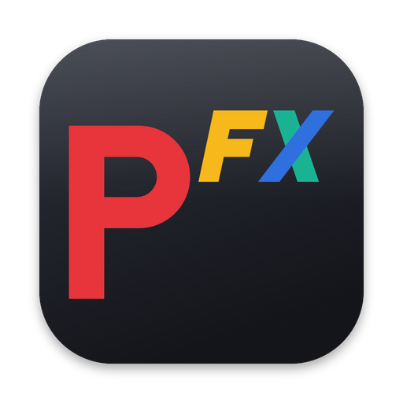
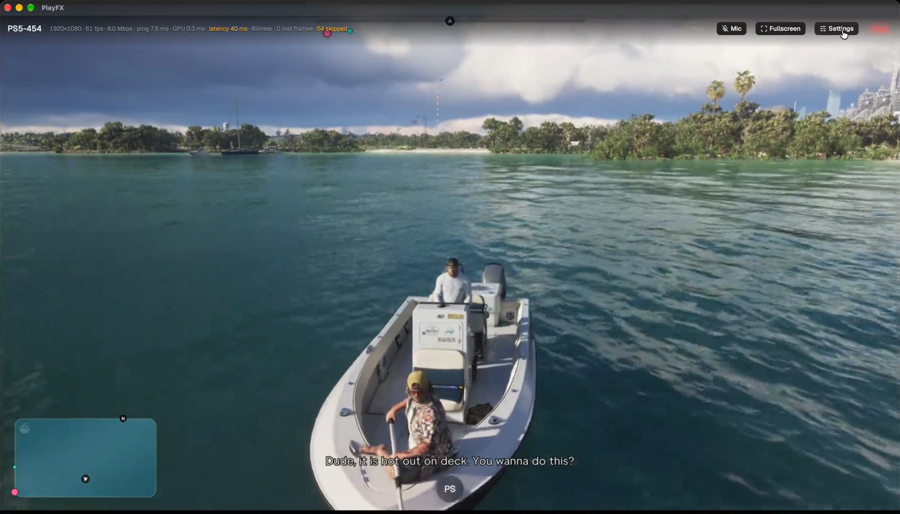
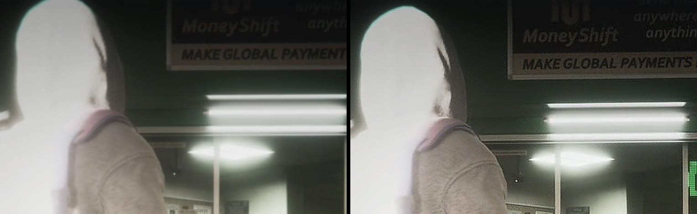

<p align="center">
  
</p>

# PlayFX

A PS5 / PS4 Remote Play client for macOS. It streams your console to the Mac with hardware HEVC
decoding, Metal + MetalFX upscaling, HDR on XDR displays, and full DualSense support: rumble,
adaptive triggers, touchpad and motion.

> PlayFX is an independent project. It is not affiliated with, endorsed by or sponsored by Sony
> Interactive Entertainment. "PlayStation", "PS5" and "DualSense" are trademarks of their owners.



**[Download the latest release](https://github.com/deblanco/PlayFX/releases/latest)** (signed and notarized,
Apple silicon, macOS 13 or later). Website: [deblanco.github.io/PlayFX](https://deblanco.github.io/PlayFX/).

## Features

- **Connect:** finds consoles on the local network, wakes them from rest, pairs with a PIN, and plays
  over the internet through PSN when the local network can't reach the console.
- **Reconnects on its own:** when the connection drops, when the Mac changes network, and when the picture
  stops while the stream goes on (no new frame for 5 s, sound still playing: the video stopped getting
  through). Up to 3 times in a row; then it goes home and says why.
- **Video:** H.264 and HEVC decoded with VideoToolbox, then a Metal picture pipeline: artifact clean-up,
  MetalFX spatial upscaling (optional Apple ML super-resolution first), CAS sharpening, color-managed
  output, HEVC HDR10 shown in EDR, frame pacing on a stream clock and optional frame interpolation
  (see [Video](#video)).
- **Audio:** low-latency playback with output device and volume choice; a microphone for voice chat.
- **Controllers:** DualSense, DualShock 4, Xbox and MFi pads through GameController, with rumble, adaptive
  triggers, touchpad and motion. The Mac keyboard works as a controller, and the trackpad works as the
  touchpad (hold ⌥ Option).
- **Real DualSense haptics:** PS5 games drive the DualSense's motors with an audio stream. With the pad on a
  USB cable, PlayFX plays that stream on the pad's motors as it is, so you get the feel the game was made
  with. On macOS the pad ignores that audio until it's switched into its audio-haptics mode, which PlayFX
  does itself (an empty HID output report, repeated while the haptics play). One-time setup: in Audio MIDI
  Setup, set the DualSense's output to 4 channels (Quadraphonic); if it's left at 2, the log says so and
  rumble is used. Over Bluetooth the stream goes to the pad in HID
  reports (built, not yet verified on a pad); if that doesn't open, it becomes rumble. The light bar colour
  and player number follow the game. When PlayFX quits, or is ended by SIGTERM, SIGINT or SIGHUP, it stops
  the rumble, trigger effects and haptics first, so the pad doesn't keep playing them.
- **Steady Wi-Fi:** pauses AirDrop and Handoff while PlayFX is open. They take the Mac's Wi-Fi off your
  network for about 90 ms every second, and the stream stalls with it (see below).
- **Status:** an on-screen stats line (frame rate, bitrate, latency, lost frames); pairing keys are
  kept in the macOS Keychain (release builds).

See [PLAN.md](PLAN.md) for what's verified on hardware and what's next.

## Install

Download the latest `PlayFX_<version>_aarch64.dmg` from [Releases](https://github.com/deblanco/PlayFX/releases),
open it and drag PlayFX to Applications. It's signed and notarized, so it opens without warnings. It needs a Mac
with Apple silicon on macOS 13 or later (frame interpolation and ML upscaling need macOS 26).

The first time:

1. Turn on Remote Play on the console: Settings › System › Remote Play › Enable Remote Play. So PlayFX can wake
   it from rest mode, also turn on Stay Connected to the Internet and Enable Turning On PS5 from Network in
   Settings › System › Power Saving › Features Available in Rest Mode.
2. With the Mac on the console's home network, open PlayFX, sign in with PlayStation (Sony's own page),
   pick the console and enter the 8-digit code from Settings › System › Remote Play › Pair Device (Link Device
   on some versions; on a PS4, Settings › Remote Play Connection Settings › Add Device). The code is valid for
   about 5 minutes.
3. Press Play. Once paired, it also plays over the internet through PSN.

For real DualSense haptics, connect the pad with a USB cable and, once, set its output to 4 channels
(Quadraphonic) in Audio MIDI Setup.

Setup step by step, answers to common problems, the keyboard controls and where PlayFX keeps your data:
[Help](docs/HELP.md) (also under **Help** in the app).

## Updating

From 0.2.4 on, PlayFX updates itself from [GitHub Releases](https://github.com/deblanco/PlayFX/releases). It
checks for a new version 5 seconds after it opens and every 6 hours while it's open; **Settings › Diagnostics ›
Check for updates** checks at any time. A new version shows on the home screen, never over a stream:

- **Update** downloads it (with its progress), checks its signature, puts it in place of the app wherever the app
  is (`/Applications`, `~/Applications`…) and restarts PlayFX. It waits while a stream is running or starting
  ("Finish playing to update"); started during the download, the update installs and **Restart** waits for the
  stream to end. If it can't (no network, a folder it can't write to), it says why and offers
  **Download from GitHub**.
- **Later** hides it until a newer version comes out (checking by hand shows it again).
- **What's new** opens the release's page.

**0.2.3 and earlier have no updater: install 0.2.4 or later from the DMG once**; it updates itself from then on.

How it works: `scripts/release.sh` packs the notarized, stapled app into `PlayFX_<version>_aarch64.app.tar.gz`,
signs it with the updater key (minisign; the private key stays in the owner's keychain, and each release first
signs a scratch update with it, so a wrong or cut-off key stops it before the build) and writes
`latest.json`; both are assets of the GitHub release, next to the DMG. The app reads
`releases/latest/download/latest.json` with [Tauri's updater](https://v2.tauri.app/plugin/updater/), which
refuses an update whose signature doesn't match the public key in `tauri.conf.json` or that was signed for
another version. The check sends nothing about you: GitHub sees a download request, like any other.

**Testing an update against a local server:** set `PLAYFX_UPDATE_ENDPOINT` to the URL of a `latest.json` when
starting PlayFX (any build; https, or http only on this Mac), e.g.
`PLAYFX_UPDATE_ENDPOINT=http://127.0.0.1:8000/latest.json /Applications/PlayFX.app/Contents/MacOS/PlayFX`. The
update still has to be signed with the release key. Development builds don't check on their own; **Check for
updates** does.

## Video

The console sends at most 1080p, so most of the picture's quality is decided before the Mac gets it.
PlayFX asks for as much as the console will send, then cleans up, upscales and sharpens each frame on
the GPU. Picture settings apply to the next frame. Stream settings apply on the next connection; the HUD
offers **Reconnect** when one changes.


*Settings → Picture, in Split view: the left half is the stream as it arrives, the right half has the
picture steps applied, and the strip at the top shows which steps are on.*



*A 720p stream as it arrives (left) and with ML super-resolution, MetalFX and sharpening (right), zoomed in:
the sign's text and the jacket's texture come back.*

### What the console sends (Settings → Stream)

| Setting | Choices | Notes |
|---|---|---|
| Resolution | 540p, 720p, 1080p | 1080p is the highest the Remote Play protocol offers here. |
| Frame rate | 30, 60 fps | |
| Codec | H.264, HEVC | HEVC gives a better picture at the same bitrate, and is needed for HDR. |
| Bitrate | Auto, 10–50 Mbps | 20 Mbps by default. Auto is the console's default (about 15 Mbps at 1080p). It pays off in motion: switching tiles at 1080p measured 5.8 Mbps at Auto against 9.5 Mbps with a 40 Mbps cap. |
| Auto-downgrade | on / off | Lets the console lower the resolution on a weak network. The stats line shows a lower resolution than you asked for in amber. |
| HDR | on / off | HEVC HDR10 (see below). |

**Settings → Misc** has the controller's **Touchpad touches** (on / off, changes right away). Off sends only
the touchpad click, not where a finger rests: in GTA VI a resting thumb opens the map. The Mac's trackpad as
the touchpad isn't affected.

### The picture pipeline (Settings → Picture)

Each frame goes through these stages in order. The Settings sheet shows them as a strip, lit amber where
a stage changes the picture.

```
VideoToolbox decode ─▶ ML super-resolution ─▶ YCbCr → RGB ─▶ clean-up ─▶ upscale ─▶ sharpen ─▶ color ─▶ screen
 (hardware, H.264/HEVC)  (optional, ≤ 720p)     (matrix, range,   (deblock,   (MetalFX   (CAS)     (sRGB or
                                                 chroma siting)    deband)     or bilinear)          EDR)
```

| Stage | What it does | Default |
|---|---|---|
| **Decode** | VideoToolbox, in hardware. 8-bit NV12 for SDR, 10-bit for HDR. | — |
| **ML upscaling first** | Apple's low-latency ML super-resolution (`VTLowLatencySuperResolutionScaler`, macOS 26+) on the decoded frame, before anything else. Runs whenever the window is larger than the stream. The model takes sides up to 1280 px that are multiples of 16, so 1080p goes through in two overlapping 1088×1088 tiles and 540p is padded to 544 rows. The biggest visible gain of the pipeline (much crisper hair and edges). It runs on its own lane ahead of the stream clock, never in the draw, so a refresh never waits for it; it adds about 6 ms of latency at 720p and up to 15 ms at 1080p. | on |
| **Colors in** | The YCbCr matrix (BT.601/709/2020), range (limited/full) and chroma siting are read from every frame, with manual overrides. Chroma is brought to full size with a bicubic (Catmull-Rom, "Sharp") or bilinear ("Smooth") filter. | Auto, Sharp |
| **Clean-up** | One compute pass at the stream's own size, before upscaling. **Blockiness** smooths small steps on HEVC's 8×8 block grid; **Banding** removes contours in gradients (fog, skies) and adds a faint dither. Both 0–1. | off |
| **Upscale** | MetalFX spatial upscaling to the window's size, or bilinear. Letterboxed to the stream's aspect ratio. | MetalFX |
| **Sharpen** | AMD FidelityFX Contrast Adaptive Sharpening (CAS), after the upscaler, at the output size. 0.3 is subtle, 0.6 clearly crisper, 1.0 still free of halos. | 0.3 |
| **Colors out** | **Accurate** tags the output as sRGB, so macOS color-manages it to the display. **Vivid** leaves it unmanaged and uses the display's full gamut (more saturated on P3 screens). | Accurate |

The whole pipeline measured 2.9 ms of GPU time per frame for 720p → window with MetalFX, sharpening
and the split view on, well inside a 60 fps frame. The stats line shows the live GPU time.

How ML upscaling takes 1080p (two overlapping tiles), the sizes Apple's model really accepts, and what it
costs: [docs/ML_UPSCALING.md](docs/ML_UPSCALING.md).

**View** compares the result with the raw stream: **Original** (no clean-up, upscaling, sharpening, ML
or interpolation), **Split** (Original on the left, your settings on the right, with a divider), and
**Enhanced** (your settings, the default).

**Profiles** keep a set of stream and picture settings, and Touchpad touches, under a name. Two are built in, listed first:
**Recommended** (1080p60 · HEVC · 20 Mbps · MetalFX · sharpness 0.3 · ML upscaling · Frame interpolation) is what a new
install starts with, and **GTA VI** is the same at 30 fps with ML upscaling and Touchpad touches off. **Save as…** also replaces a saved
profile: pick it, and Save becomes Replace. A profile saved as "GTA VI" before that one was built in shows as "GTA VI
(saved)".

### HDR

With **HDR** on (HEVC only), PlayFX asks the PS5 for HEVC HDR10. Frames tagged with the PQ curve switch
the renderer to HDR:

- 10-bit decode, and 16-bit float textures through clean-up, MetalFX (in its HDR mode) and sharpening;
- PQ turned into light in BT.2020, with SDR white (203 nits) at 1.0;
- an EDR layer, so highlights go brighter than white on XDR and other HDR displays.

It switches back to SDR on its own for SDR frames. ML upscaling takes 8-bit frames only, so it sits out in
HDR. Frame interpolation works in HDR with MetalFX's frame interpolator instead of VideoToolbox's (which takes
8-bit frames only), making one image between two frames rather than up to three. HDR is verified on a PS5
with Silent Hill 2 on a MacBook Pro's XDR display; frame interpolation in HDR so far only offscreen, on
synthetic HDR frames.

### Frame pacing and interpolation

- **Frames are shown by a stream clock, not when they arrive.** Each frame gets a time from the stream's
  frame index and the stream's rate, so network jitter neither drops nor bunches frames. Before this, a
  60 fps stream showed 39–49 of its 60 frames a second on a 60 Hz screen.
- **Two drawables, not three**, so a decoded frame waits at most one refresh.
- **Frame interpolation** (on by default) makes images between the game's own frames, one for each
  screen refresh, so a 30 fps game fills a 60 Hz screen (and a 120 Hz one), even when it comes in a 60 fps
  stream: the frames the console repeats are left out first. It runs when the screen refreshes at least
  1.2× as often as the game. The images come from VideoToolbox frame interpolation on the Neural
  Engine (MetalFX's frame interpolator for HDR streams), on their own queue, so a refresh never waits for one. It
  works at a smaller size when the stream's own is too slow, blends still areas (HUDs, subtitles) back
  from the real frames, and skips scene cuts.
- Measured on a 30 fps clip with jitter: 57–59 images shown a second. The cost is latency: the display
  runs about 40–45 ms behind the stream clock, because an in-between image can't exist before the next
  real frame. For fast games, 60 fps without interpolation feels more responsive.

How it works, the research behind it and every measurement:
[docs/FRAME_INTERPOLATION.md](docs/FRAME_INTERPOLATION.md).

### Measuring it

- **Stats on screen** shows resolution (amber when lower than asked), frame rate (the game's beside the
  stream's when it's slower, and images shown, with interpolation), bitrate (with the console's target),
  ping, GPU time, latency (decode + display, amber at 33 ms or more), the active upscaler, the images frame
  interpolation made per second, HDR when on, lost and skipped frames, and why a step that's on is idle
  ("Bilinear (no upscale needed)", "no interpolation: 60 fps on a 60 Hz screen"). The pacing delay and a
  latency test are available through the [dev control port](docs/dev-control.md).
- `psrp stream` renders the latest frame with any settings: `/render.png?mode=…&w=…&h=…`, and
  `/grid.png?vary=…&values=…&crop=…` for a same-frame grid, one tile per value. `/frameinfo` dumps a
  frame's colorimetry.

Not planned: MetalFX temporal upscaling, which needs the game's motion vectors and depth.

## The protocol

PlayFX speaks the Remote Play protocol with its own Swift package,
[PlayFXProtocol](packages/playfxprotocol). The stream is read from a BSD socket on its own user-interactive
thread with no allocation per packet; its packets are marked for Wi-Fi's video queue (`NET_SERVICE_TYPE_VI`)
and stamped by the kernel on arrival, and the wait for a missing video packet is measured from the link (3–20 ms,
shown in Settings › Diagnostics). Video decodes asynchronously on VideoToolbox's threads, so the receive thread
never waits for a frame. Design and measurements: [packages/playfxprotocol/DESIGN.md](packages/playfxprotocol/DESIGN.md);
the protocol itself: [docs/protocol](docs/protocol/README.md).

## Playing over Wi-Fi

AirDrop, Handoff, Universal Control and wireless Sidecar run over AWDL, a peer-to-peer Wi-Fi link that
shares the Mac's single radio. While it's on, the radio leaves your network's channel about once a second.
Measured from a Mac to a PS5, the worst ping went from about 100 ms, once every second, to 21 ms with AWDL
off.

- Turn on **Steady Wi-Fi**, on Home or in Settings → Stream. macOS asks for your password once. AirDrop
  and Handoff come back when you turn it off or quit PlayFX.
- Or by hand: `sudo ifconfig awdl0 down`. Use `sudo ifconfig awdl0 up` to undo it; macOS also brings it
  back by itself after a while.
- Put the Mac and the PS5 on the same network, wire the PS5 if you can, and use 5 or 6 GHz on the Mac.

The details and the measurements are in [docs/NETWORK.md](docs/NETWORK.md).

## Layout

```
apps/desktop            Tauri v2 app: React + Effect + Tailwind/shadcn UI in a transparent webview
                        over a native Metal view; Rust bridge to StreamCore.
packages/streamcore     Swift package: the stream session, VideoToolbox decode, Metal/MetalFX,
                        audio, controller input. Also the `psrp` CLI for headless debugging.
packages/playfxprotocol Swift package: PlayFX's own Remote Play protocol implementation
                        (discovery, pairing, the stream, internet play through PSN).
```

## Build from source

Requires an Apple silicon Mac, Xcode, [Bun](https://bun.sh) and Rust (stable).

```sh
git clone https://github.com/deblanco/PlayFX.git
cd PlayFX
bun install
bun run desktop                               # run the app (dev)
bun run desktop:build                         # build the .app
```

## Checks

Every package keeps line, branch and function coverage at or above 80%.

```sh
bun run --cwd apps/desktop check                       # tsc, ESLint, vitest + coverage
packages/streamcore/scripts/coverage.sh                # Swift tests + coverage
bun run --cwd apps/desktop coverage:rust               # Rust (cargo llvm-cov)
```

## Debugging without the app

`psrp` drives StreamCore headlessly:

```sh
cd packages/streamcore && swift build --product psrp
.build/debug/psrp discover
.build/debug/psrp register --host 192.168.1.20 --pin 12345678
.build/debug/psrp stream          # control API on http://127.0.0.1:7777 (/status, /snapshot.png, /press…);
                                  # every request needs the header X-PSRP: 1 (curl -H 'X-PSRP: 1' …)
.build/debug/psrp pad             # the Mac's controller without a console: live state, rumble, triggers
```

Pairing keys are saved to `~/.config/psrp/config.json`. Keep that file private.

A development build of the app can also be driven over HTTP (settings, play, button presses, stats)
with the [dev control port](docs/dev-control.md).

How frame interpolation and frame pacing work, what was measured, and how to bench them without a
console (`psrp interpolate`, `psrp play`): [docs/FRAME_INTERPOLATION.md](docs/FRAME_INTERPOLATION.md).

What makes a stream stutter on the network, and what PlayFX does about it:
[docs/NETWORK.md](docs/NETWORK.md).

## License

PlayFX is proprietary: Copyright (C) 2026 Daniel B. All rights reserved (see [LICENSE](LICENSE)). The
third-party software it includes keeps its own licence; [THIRD_PARTY_LICENSES](THIRD_PARTY_LICENSES) lists
each component with its copyright notices and full licence text, and the app carries it in its Resources
folder.

## Sony and PlayStation Network

PlayFX is an unofficial client for your own consoles and your own PlayStation account. It talks to the
console with the same Remote Play protocol as Sony's app. It signs in to PSN only through Sony's own
sign-in page, and keeps the result on your Mac. No credentials ship with PlayFX, and none are sent
anywhere else. Using it is subject to Sony's terms for PlayStation Network.
